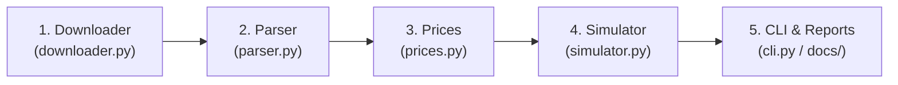

# Multi-Source Substack Downloader & Portfolio Backtester

[](https://www.python.org/)
[](https://opensource.org/licenses/MIT)

An end-to-end investment research system that archives, parses, and backtests recommendations from multiple paid Substack stock pickers against the **S&P 500 (`SPY`)** under dollar-matched cash-flow conditions.

---

## 🧭 Navigation & Analysis Reports

All quantitative studies, risk evaluations, and track-record reconciliations are documented in [`docs/`](docs/):

| Document | Link | Description |
|---|---|---|
| 🎯 **Universal Checkpoint Audit** | [**`docs/CHECKPOINT_RECONCILIATION.md`**](docs/CHECKPOINT_RECONCILIATION.md) | Universal point-in-time portfolio reconciliation auditing 23 checkpoints across all 3 publications with automated error investigation. |
| 🔍 **Root Cause & Reliability Audit** | [**`docs/ROOT_CAUSE_AUDIT.md`**](docs/ROOT_CAUSE_AUDIT.md) | In-depth investigation of omitted positions (`013030.KQ`, `453340.KS`, `139130.KS`, `IFOS`), paywall stub caching bugs, and failure mode fixes. |
| 🛡️ **Source Coverage & Reconciliation** | [**`docs/COVERAGE_REPORT.md`**](docs/COVERAGE_REPORT.md) | Full source-to-trade reconciliation across all 3 publications, orphan holding detection, disappearance warnings, and 8-point metrics. |
| 📜 **Complete Trade Histories** | [**`docs/TRADE_HISTORY.md`**](docs/TRADE_HISTORY.md) | Chronological trade logs with entry/exit prices, sizing, ratings, and source post references. |
| 📊 **Performance Comparison** | [**`docs/PERFORMANCE_COMPARISON.md`**](docs/PERFORMANCE_COMPARISON.md) | Head-to-head backtest results (Jan 1, 2026 to present), Strategy A vs. Strategy B sensitivity, and top/bottom performers. |
| ⚖️ **Risk & Volatility Analysis** | [**`docs/RISK_ANALYSIS.md`**](docs/RISK_ANALYSIS.md) | Win rates, loss distributions, profit factors, single-stock concentration, and operational complexity. |
| 📝 **Author Claims Reconciliation** | [**`docs/AUTHOR_RECONCILIATION.md`**](docs/AUTHOR_RECONCILIATION.md) | Line-by-line audit reconciling author-claimed returns (+23.59% YTD, 2.55x SPY, 11 closed trades) against market quotes. |
| 📁 **Documentation Index** | [**`docs/README.md`**](docs/README.md) | Central hub linking all research reports, trade histories, and source profiles. |

---

## 🏆 2026 Head-to-Head Performance Snapshot

*Backtested from January 01, 2026 to present under identical dollar-matched cash flows ($1,000 unit size):*

| Newsletter / Publication | Strategy A ROI | Strategy A XIRR | Strategy B ROI | Strategy B XIRR | Matched SPY XIRR (A / B) | Win Rate (Strat A) | Worst Loss |
|---|---|---|---|---|---|---|---|
| **Beating The Tide** | **+16.45%** | **+23.23%** | **+7.58%** | **+15.83%** | +10.12% / +7.44% | 47.6% (10W / 9L) | `STRL` (-53.3%) |
| **TJ Stocks** | **+21.00%** | **+30.13%** | **+21.00%** | **+30.13%** | +9.87% / +9.87% | **76.9%** (10W / 3L) | `FELE` (-10.1%) |
| **Cluseau** | **+22.66%** | **+33.12%** | **+15.00%** | **+29.74%** | +10.26% / +8.07% | **73.1%** (19W / 7L) | `IFOS` (-30.0%) / `013030` (-26.3%) |

> **Strategy Definitions**:
> - **Strategy A**: Buy all existing active `BUY` recommendations at $T_0$ (Jan 1, 2026) + execute subsequent buys/adds/trims/sells.
> - **Strategy B**: Only execute fresh `BUY`/`ADD` signals initiated from $T_0$ onward.
> - **Matched SPY Benchmark**: An identical dollar cash flow invested into `SPY` on the exact dates trades are executed and liquidated on the same exit dates.
> - **Note on Data Defensibility**: All trades are verified against point-in-time archived publication records and chat alerts without retrospective contamination or synthetic backdating. Korean equities (`402340.KS`, `453340.KS`, `139130.KS`, `013030.KQ`) and Japanese equities (`9478.T`, `7089.T`, `9220.T`, `6626.T`) are multi-currency FX-converted, `WYFI` is confirmed closed in Oct 2025 (+5%) before 2026, and TJ Stocks ETF 2.0 rebalance sales (`SPB`, `MSCI`, `FDX`) are fully executed.

---

## 🧠 LLM & Developer Architecture Guide

This section explains the system mental model, directory layout, and data pipeline to help future LLM agents and human developers quickly understand and modify the codebase.

### 1. Where Does Publication Data Live?
**All active publications live strictly inside [`sources/<name>/`](sources/)**:
- [`sources/beatingthetide/`](sources/beatingthetide/): 247 post JSONs, 48 Datawrapper CSV tables, baseline holdings, and trade events.
- [`sources/tjstocks/`](sources/tjstocks/): 417 post JSONs, StockTok ETF baseline holdings, and trade events.
- [`sources/cluseau/`](sources/cluseau/): 52 post JSONs, 404 subscriber chat threads, and trade events.
- *(Note: Any raw legacy scraping dumps from earlier single-source iterations are archived in `legacy_mirrors/` and ignored by git).*

### 2. The 4-Stage Data Pipeline



1. **`btt_sim/downloader.py` (Ingestion)**:
   - Fetches all post metadata and HTML via Substack REST API (`/api/v1/archive` and `/api/v1/posts/<slug>`).
   - Automatically detects and resolves Datawrapper meta-refresh redirects (`/1/`, `/2/`, ...) to download true underlying CSV datasets.
   - Scrapes authenticated Substack Chat REST endpoints (`/api/v1/chat/channels/<id>/posts`) with cursor pagination.
2. **`btt_sim/parser.py` (Signal Extraction)**:
   - Scans Datawrapper CSVs, HTML tables, and Substack `StockTickerToDOM` widgets for portfolio holdings and target weights.
   - Extracts trade actions (`BUY`, `ADD`, `TRIM`, `SELL`) from review exit headings (e.g. `1. CBL Properties (CBL) +114% - Exited September 15, 2026`) and author chat alerts.
   - Outputs standardized `sources/<key>/data/trade_events.csv` and `portfolio_holdings.csv`.
3. **`btt_sim/prices.py` (Market Data Resolution)**:
   - Resolves multi-exchange tickers (`.TO` Canada, `.KS` Korea, `.T` Japan, `.PA` France, etc.) via `yfinance`.
   - Caches daily adjusted close prices locally in `data/price_cache/` to ensure fast, deterministic backtests.
4. **`btt_sim/simulator.py` (Portfolio Backtesting)**:
   - Simulates Strategy A vs. Strategy B under fixed unit ($1,000 per BUY) or target weight allocation.
   - Computes irregular cash-flow annualized XIRR via Newton-Raphson with bisection fallback.
   - Runs dollar-matched cash-flow benchmark against `SPY`.

---

## 📂 Repository Directory Layout

```text
├── btt_sim/                   # Core Python Simulation Engine
│   ├── cli.py                 # CLI entry point (`btt` commands: check-auth, download, parse, simulate, compare, trades, sweep)
│   ├── config.py              # Settings dataclass & SourceConfig definitions
│   ├── downloader.py          # Substack API scraper, Datawrapper redirect resolver & Chat archiver
│   ├── parser.py              # Recommendation parser & trade event extractor
│   ├── prices.py              # Multi-exchange yfinance price provider & local price cache
│   └── simulator.py           # Cash-flow matching engine, irregular XIRR & mark-to-market valuations
├── docs/                      # Research, Analysis & Track-Record Reconciliations
│   ├── README.md              # Documentation navigation index
│   ├── TRADE_HISTORY.md       # Central trade history directory
│   ├── PERFORMANCE_COMPARISON.md  # Detailed 2026 backtest comparison
│   ├── RISK_ANALYSIS.md       # Quantitative risk matrix & volatility assessment
│   └── AUTHOR_RECONCILIATION.md   # Line-by-line audit of author claims vs. market data
├── sources/                   # Fully Segregated Publication Data
│   ├── beatingthetide/        # Beating The Tide data, README, and TRADE_HISTORY.md
│   │   ├── api_posts/         # Downloaded JSON records for all posts
│   │   ├── datawrapper/       # 48 versioned Datawrapper CSV tables
│   │   ├── data/              # portfolio_holdings.csv & trade_events.csv
│   │   └── TRADE_HISTORY.md   # Chronological trade history log
│   ├── tjstocks/              # TJ Stocks data, README, and TRADE_HISTORY.md
│   │   ├── api_posts/         # Downloaded JSON records (StockTok ETF posts)
│   │   ├── data/              # portfolio_holdings.csv & trade_events.csv
│   │   └── TRADE_HISTORY.md   # Chronological trade history log
│   └── cluseau/               # Cluseau data, README, and TRADE_HISTORY.md
│       ├── api_posts/         # Downloaded JSON records (Quarterly Reviews)
│       ├── chat/              # 404 archived subscriber chat threads (chat_threads.json)
│       ├── data/              # trade_events.csv
│       └── TRADE_HISTORY.md   # Chronological trade history log
├── tests/                     # Automated Test Suite (pytest)
│   └── test_simulator.py      # XIRR, parser, and strategy verification tests
├── .env.example               # Sanitized template for session cookies (secrets protected)
├── pyproject.toml             # Python package dependencies & configuration (uv)
└── README.md                  # This guide
```

---

## 🚀 CLI Quick Start & Commands

### 1. Check Authentication Status
Verify that session cookies in `.env` are valid and paid access is unlocked:
```powershell
uv run btt --source all check-auth
```

### 2. Run Completeness & Coverage Audit
Run automated reconciliation across all sources to verify source-to-trade coverage, detect orphan holdings, and flag unconfirmed position disappearances:
```powershell
uv run btt --source all audit
uv run btt --source cluseau audit
```

### 3. View Trade History in Terminal
Inspect color-coded chronological trade events for any source:
```powershell
uv run btt --source tjstocks trades
uv run btt --source cluseau trades
uv run btt --source beatingthetide trades

# Or view the most recent N trades across all sources
uv run btt --source all trades --limit 20
```

### 4. Run Head-to-Head Comparison
Compare all three publications from Jan 1, 2026:
```powershell
uv run btt compare --start 2026-01-01
```

### 5. Run Single-Source Simulation
```powershell
# Fixed unit allocation ($1,000 per BUY)
uv run btt --source tjstocks simulate --start 2026-01-01
uv run btt --source cluseau simulate --start 2026-01-01
uv run btt --source beatingthetide simulate --start 2026-01-01

# Target weight allocation (scales positions by author's target weight %)
uv run btt --source beatingthetide simulate --start 2026-01-01 --mode target_weight
```

### 6. Download New Posts or Update Chat
```powershell
uv run btt --source cluseau download --skip-sbstck-dl
uv run btt --source tjstocks download --skip-sbstck-dl
uv run btt --source beatingthetide download --skip-sbstck-dl
```

### 7. Run Test Suite
```powershell
uv run pytest
```

---

## ➕ How an LLM or Developer Can Add a 4th Source

To add a new Substack publication (e.g. `examplepub`):
1. **Define Source in `btt_sim/config.py`**:
   Add a new entry in `Settings.sources`:
   ```python
   "examplepub": SourceConfig(
       key="examplepub",
       display_name="Example Publication",
       url=os.getenv("EXAMPLEPUB_URL", "https://examplepub.substack.com/"),
       cookie_name=os.getenv("EXAMPLEPUB_COOKIE_NAME", "substack.sid"),
       cookie_val=os.getenv("EXAMPLEPUB_COOKIE_VAL"),
       base_dir=root_dir / "sources" / "examplepub",
   )
   ```
2. **Add Environment Variables in `.env` and `.env.example`**:
   ```ini
   EXAMPLEPUB_URL=https://examplepub.substack.com/
   EXAMPLEPUB_COOKIE_NAME=substack.sid
   EXAMPLEPUB_COOKIE_VAL=s%3A...
   ```
3. **Add Parsing Rules in `btt_sim/parser.py`**:
   In `parse_source_data(source)`: add extraction logic for `examplepub`'s specific post format or portfolio tables.
4. **Run Ingestion & Simulation**:
   ```powershell
   uv run btt --source examplepub download
   uv run btt --source examplepub parse
   uv run btt --source examplepub simulate --start 2026-01-01
   ```
